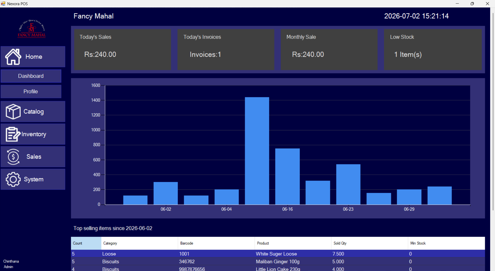
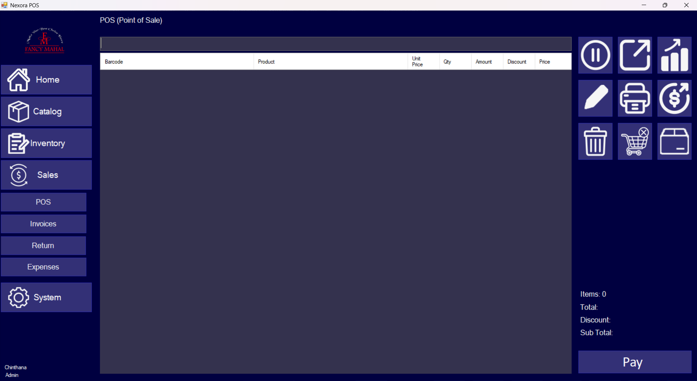
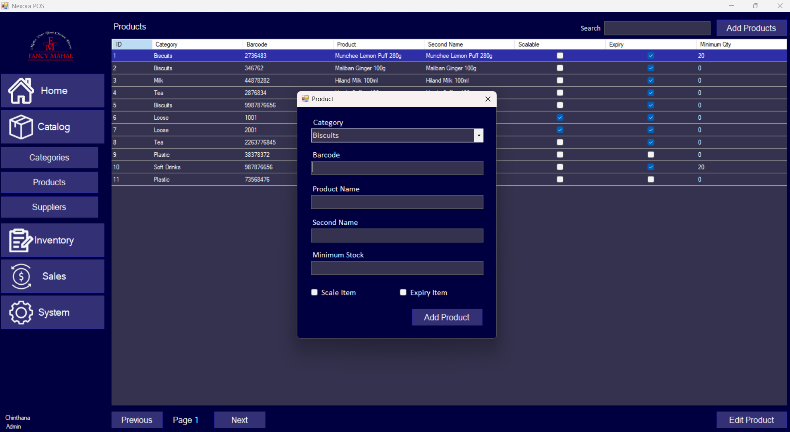
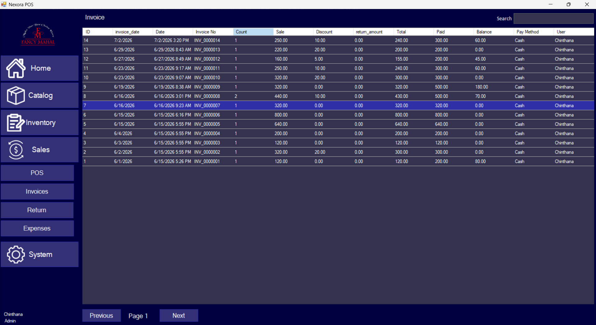
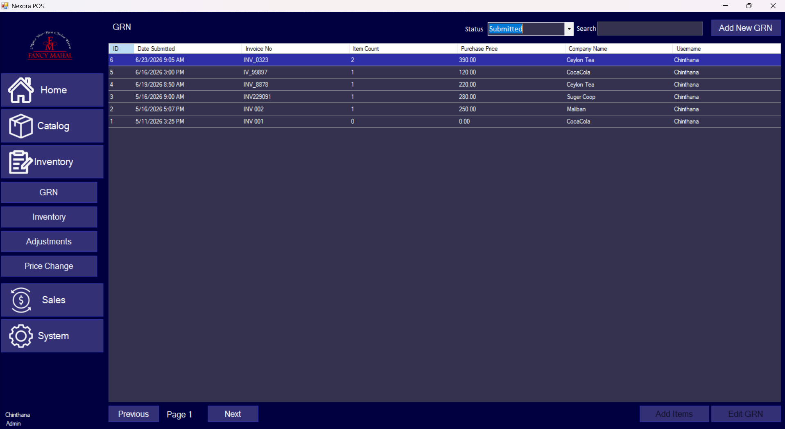
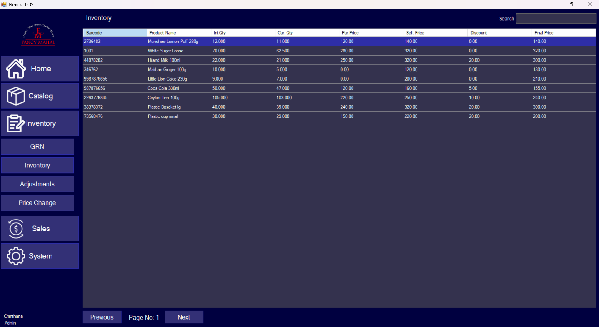
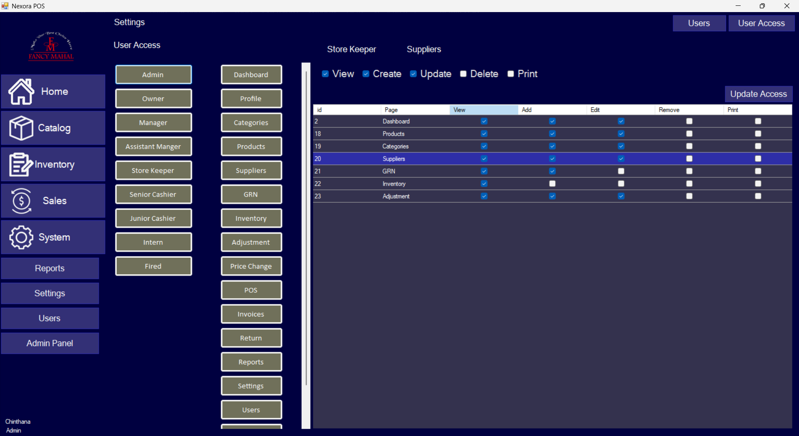
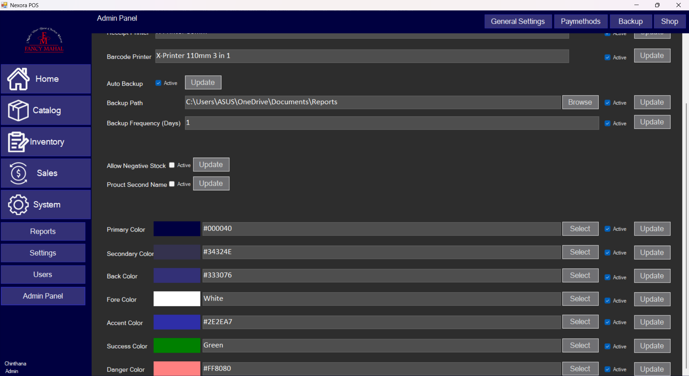
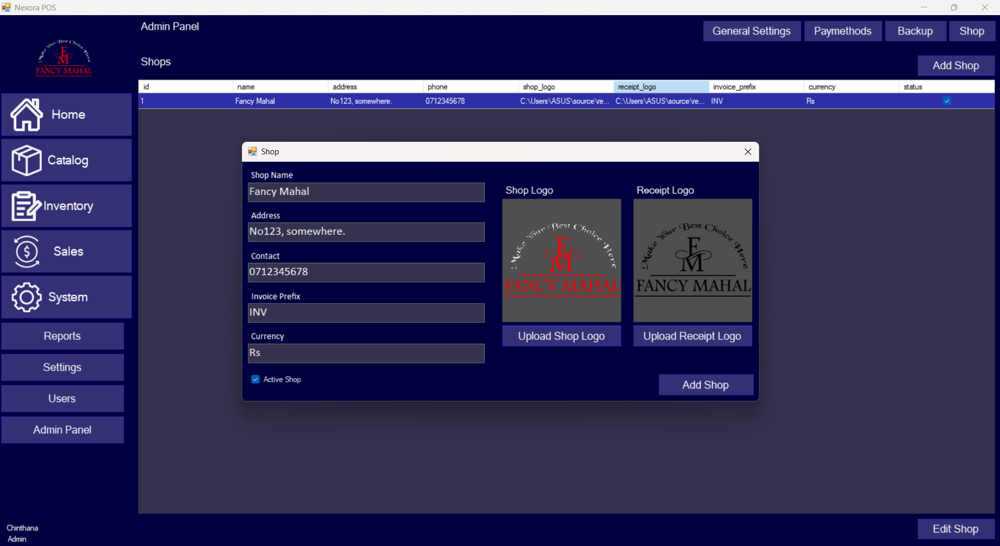
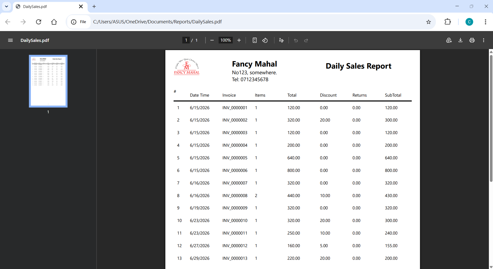

# ModernPOS – Desktop Point of Sale System

**ModernPOS** is a desktop Point of Sale (POS) application developed using **C# Windows Forms** and **.NET**. The system is designed for small and medium-sized retail businesses, providing an efficient solution for sales processing, inventory management, purchasing, and business reporting.

The application follows a modular architecture, making it maintainable, scalable, and easy to extend with new features.

---

## Overview

ModernPOS streamlines day-to-day retail operations by combining sales, inventory, purchasing, and reporting into a single desktop application.

The system provides an intuitive user interface that enables cashiers and administrators to perform daily operations quickly and efficiently.

---

## Features

### Product Management
- Create, edit, and delete products
- Product categorization
- Barcode support
- Product search

---

### Goods Received Notes (GRN)
- Record supplier deliveries
- Update inventory automatically
- Purchase cost tracking

---

### Inventory Management
- Real-time stock monitoring
- Stock availability tracking
- Inventory adjustments
- Low-stock monitoring

---

### Modern POS Billing
- Fast billing interface
- Barcode scanning support
- Quantity and discount handling
- Multiple payment methods
- Receipt printing

---

### Customer & Supplier Management
- Customer registration
- Supplier management
- Customer purchase history
- Supplier information management

---

### Sales & Purchase Returns
- Process customer returns
- Purchase return management
- Automatic stock updates

---

### Stock Adjustments
- Increase or decrease stock manually
- Inventory correction support
- Adjustment history

---

### Expense Management
- Record business expenses
- Expense categorization
- Expense history

---

### Reports & Analytics
- Sales reports
- Purchase reports
- Inventory reports
- Expense reports
- Profit analysis
- Interactive dashboard
- Business performance charts

---

### Role-Based Access Control (RBAC)
- Administrator access
- Cashier access
- Permission-based features
- Secure authentication

---

### Customization
- Theme switching
- Color customization
- Modern desktop interface

---

### Receipt Printing
- Printable customer receipts
- Thermal printer support
- Professional receipt layout

---

## Technology Stack

| Technology | Description |
|------------|-------------|
| Language | C# |
| Framework | .NET Windows Forms |
| Database | MySQL |
| IDE | Visual Studio |
| Reporting | Custom Reporting |
| Charts | Windows Forms Chart Controls |

---

## Screenshots

<p align="center">
  
  
</p>
<p>
  
  
</p>
<p>
  
  
</p>
<p>
  
  
</p>
<p>
  
  
</p>

---

## 🛠️ Installation

### Clone the repository

```bash
git clone https://github.com/your-username/ModernPOS.git
```

### Open the project

Open the solution file using **Visual Studio**.

### Configure the database

Update the database connection string with your MySQL server details.

### Run the application

Build and run the project from Visual Studio.

---

## 🎯 Design Goals

- Modern and intuitive user interface
- Fast billing process
- Easy inventory management
- Reliable business reporting
- Scalable architecture
- Easy maintenance and future expansion

---

## 🚀 Future Improvements

- Barcode label generation
- Multi-branch support
- Customer loyalty program
- Cloud synchronization
- Mobile dashboard
- Online backup
- Electronic invoice generation

---

## 📄 License

This project is published for portfolio and demonstration purposes.
